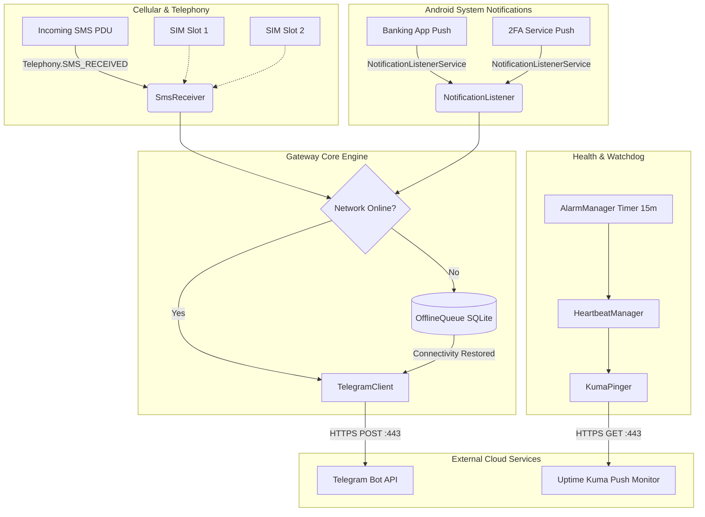

# 🏗️ Architecture & Component Design — GIN-Telegram-Bot

> **Technical architecture, event-driven data flow, lifecycle management, and offline queue resilience.**

---

## 1. System Architecture Diagram

---

## 2. Core Modules

### 2.1. SMS Receiver (`SmsReceiver.java`)
- Registered with priority `2147483647` (`Integer.MAX_VALUE`) to ensure immediate interception before default messaging apps.
- Reassembles multipart PDU segments into cohesive messages.
- Resolves active SIM card slot index using `SubscriptionManager` (Android 5.1+) and MediaTek vendor extras (`slot`, `simId`).

### 2.2. Notification Listener (`NotificationListener.java`)
- Subclasses `NotificationListenerService` to capture status-bar notifications.
- Ignores ongoing/unclearable notifications (music players, system downloads).
- Enforces dynamic package whitelisting to only forward user-selected banking and 2FA apps.
- Implements a 30-second deduplication cache to prevent spamming Telegram with duplicate push updates.

### 2.3. Native HTTP Transport (`TelegramClient.java`)
- Zero third-party dependencies: built strictly on Java standard `HttpURLConnection` over TLS 1.2+.
- Direct JSON payload encoding with UTF-8 byte stream writing.
- Automatic retry and fallback to `OfflineQueue` on network timeouts (`SocketTimeoutException`, `UnknownHostException`).

### 2.4. Resilient Offline Storage (`OfflineQueue.java`)
- Lightweight SQLite database storing queued messages when Wi-Fi or cellular data drops.
- Automatically flushes queued payloads in chronological order upon network reconnection.

### 2.5. Uptime Kuma Heartbeat (`HeartbeatManager.java` & `KumaPinger.java`)
- Wakes CPU every 15 minutes using `AlarmManager.setExactAndAllowWhileIdle()`.
- Collects battery percentage, charging status, Wi-Fi RSSI, and pending queue count.
- Dispatches HTTP GET push ping to trigger Uptime Kuma health checks.

---

## 🏷 Topics & Tags

#AndroidArchitecture #MermaidDiagram #EventDriven #ZeroBloat #TelegramGateway #SMSReceiver #SQLiteQueue
